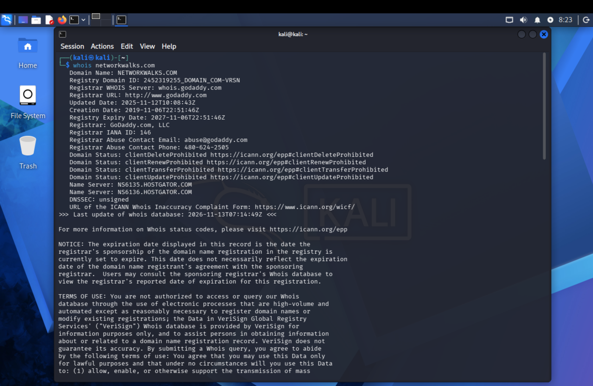
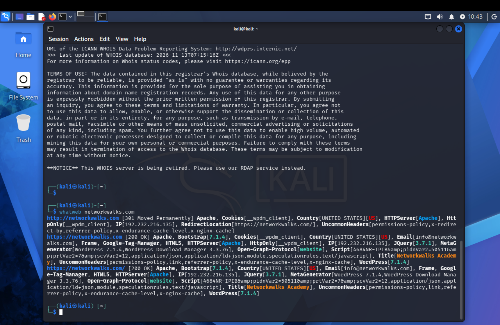
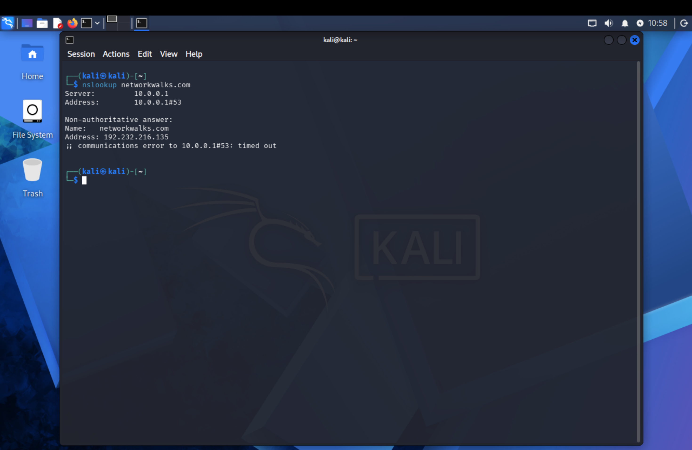
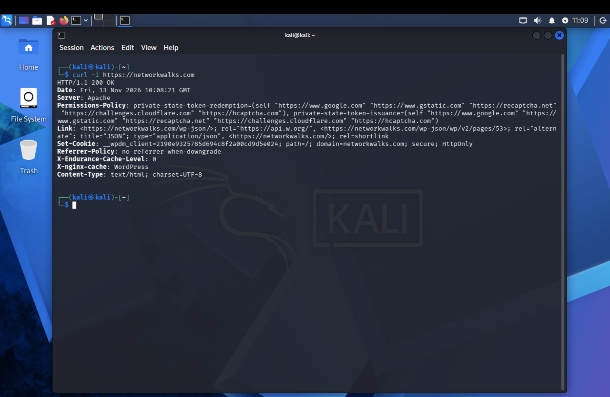
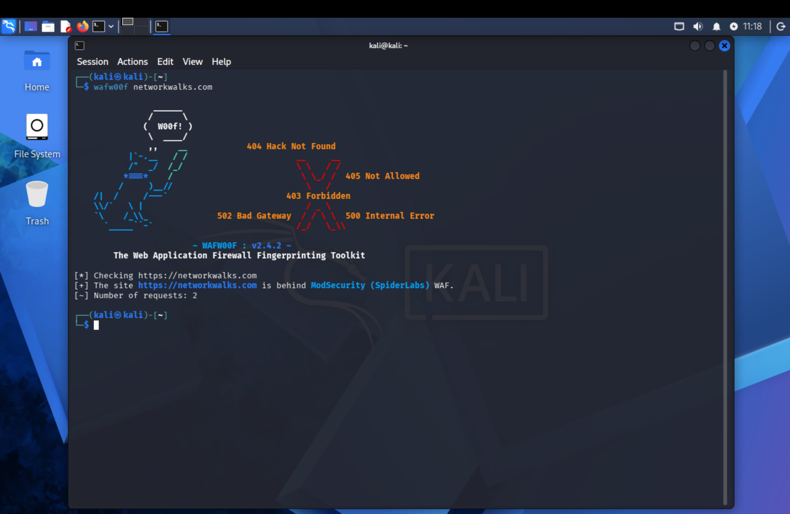
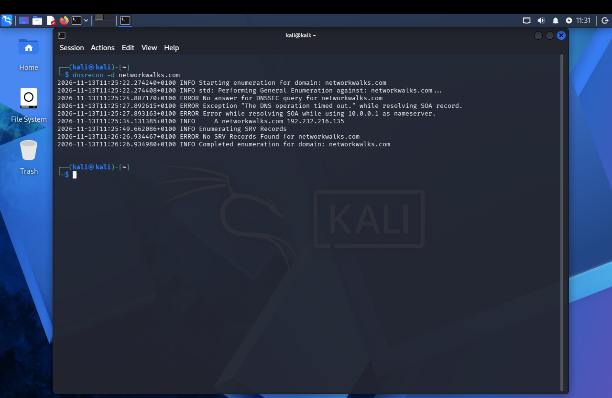

# Penetration Testing Report: Footprinting & Reconnaissance Phase

**W2-PM1 | Cybersecurity | Networkwalks**

| Field | Details |
|---|---|
| **Pentester Name** | Oluwaseun Feyisayo Olatunji (Cybersecurity Professional) |
| **Program** | Networkwalks Cybersecurity Program |
| **Date** | 13 November 2026 |
| **Module completed** | W2-PM1 (Multiple Kali Tools) |
| **Client/Target** | Networkwalks (written permission secured) |
| **Permission secured from client?** | Yes |
| **Phases covered** | Phase 1: Reconnaissance & Footprinting; Phases 2-5: In progress |

---

## 1. Liability Disclaimer

I have performed these activities only on systems and devices where I had secured written permission, or devices/systems that I own myself. All materials are for education and research purposes only. Do not use anything from here to break the law. The instructor, the authors and Networkwalks are not responsible for what you do with this knowledge. Every action you take is your own responsibility. Misuse can lead to criminal charges, heavy fines, loss of your job and a permanent record. In most countries unauthorised access is a crime even when nothing is damaged.

---

## 2. Introduction

This report covers footprinting the networkwalks.com domain using multiple Kali Linux tools (W2-PM1). It shows how an attacker gathers public information about a target before any attack is attempted. It is the Week 2 part of my ongoing internship program at Networkwalks.

All commands were run in Kali Linux. Every step below includes the exact command used, the result I observed, a screenshot as evidence, and a short note on why the finding matters from an attacker's point of view.

---

## 3. Tools Used

| Tool | Purpose |
|---|---|
| Kali Linux | Operating system used for reconnaissance activities |
| WHOIS | Find domain registration details (owner, dates, name servers) |
| whatweb | Fingerprint web technologies (server, CMS, plugins, IP) |
| nslookup | Resolve the domain name to its IP address using DNS |
| curl -I | Read the HTTP response headers of the website |
| wafw00f | Detect whether a Web Application Firewall protects the site |
| dnsrecon | Enumerate DNS records (NS, MX, SPF, TXT, SRV) |

---

## 4. Activities Performed

### 4.1 Footprinting & Reconnaissance

I performed reconnaissance against the networkwalks.com domain using six Kali Linux tools: WHOIS, WhatWeb, Nslookup, Curl, Wafw00f and DNSRecon. Each tool was used to collect a different type of information about the target.

**WHOIS:** Obtained publicly available domain registration information and identified the domain's name servers. The results provided information about the domain registration and hosting infrastructure.

```bash
whois networkwalks.com
```


**WhatWeb:** Identified technologies used by the website. The results identified WordPress 7.0.4 and WP Download Manager 3.3.58, along with other information exposed by the website.

```bash
whatweb networkwalks.com
```


**Nslookup:** Resolved the domain name to its IP address. The result identified 192.232.216.135.

```bash
nslookup networkwalks.com
```


**Curl:** Inspected the HTTP response headers using the `-I` option. This provided additional information about the web application and exposed the WordPress REST API endpoint `/wp-json/`.

```bash
curl -I https://networkwalks.com
```


**Wafw00f:** Determined whether a Web Application Firewall was protecting the website. The result identified ModSecurity (SpiderLabs).

```bash
wafw00f https://networkwalks.com
```


**DNSRecon:** Enumerated DNS records. The results provided information relating to name servers, mail servers, SPF/TXT records, service records and DNS software information.

```bash
dnsrecon -d networkwalks.com
```


---

## 5. Risk Analysis / Impact

Based on the information collected during the footprinting activities, I identified the following potential risks.

| # | Risk / Finding | Evidence / Observation | Potential Impact | Risk Level |
|---|---|---|---|---|
| 1 | Web technology information exposed | WhatWeb identified WordPress and WP Download Manager | Attackers may use exposed technology/version information to identify software requiring further security review | 🟡 Medium |
| 2 | Server IP address identifiable | Nslookup resolved the domain to 192.232.216.135 | Provides information about the network location of the web service | 🟢 Low |
| 3 | HTTP technical information exposed | Curl returned HTTP response headers and exposed /wp-json/ | May assist technology fingerprinting and further enumeration | 🟢 Low |
| 4 | WAF technology identifiable | Wafw00f identified ModSecurity (SpiderLabs) | Reveals information about the web application's security architecture | 🟢 Low |
| 5 | DNS infrastructure information exposed | DNSRecon identified DNS, mail and service-related records | DNS information can help build a broader infrastructure profile | 🟡 Medium |

**Risk level key:** 🔴 Critical | 🟡 Medium | 🟢 Low

> The risks above are observations from the footprinting exercise, not confirmed vulnerabilities. The practical exercise primarily involved information gathering. No exploitation or vulnerability validation was performed. The presence of information such as a software version, IP address or DNS record does not by itself mean that the system is vulnerable. Further authorized security testing would be required to confirm any actual vulnerability.

---

## 6. Recommendations

1. **Review publicly exposed technology information:** Organizations should regularly review what information about their web technologies, CMS and plugins is publicly visible.
2. **Keep software updated:** CMS platforms, plugins and other web technologies should be regularly updated and reviewed against current security advisories.
3. **Review HTTP headers:** HTTP response headers should be reviewed to determine whether unnecessary technical information is being exposed.
4. **Review DNS records regularly:** DNS records should be checked periodically to ensure that only required information and services are publicly exposed.
5. **Properly configure and monitor the WAF:** Keep the WAF (ModSecurity) enabled and tuned, since it already blocks naive attacks.
6. **Perform security testing with authorization:** Reconnaissance should only be performed against systems where appropriate authorization has been provided.

---

## 7. Conclusion

During Week 2 of my Cybersecurity & Ethical Hacking internship, I completed practical activities covering footprinting and reconnaissance.

I used six Kali Linux tools to collect information about the target domain. I learned how WHOIS can provide domain information, WhatWeb can identify web technologies, Nslookup can resolve domain names, Curl can inspect HTTP headers, Wafw00f can identify a WAF, and DNSRecon can provide additional DNS information.

The exercise showed me that information gathering is an important part of cybersecurity. Even before attempting to exploit a system, a security professional can learn a significant amount about an environment by carefully analyzing publicly available information.

I also learned that technical findings should be documented clearly. A good cybersecurity report should explain what was performed, what was discovered, what the observation means, what risk it may create, and what can be done to reduce that risk.

Finally, I learned that reconnaissance must always be performed within an authorized scope. These activities were completed as part of an assigned educational cybersecurity lab.

---

## 8. Evidences Collected

All screenshots are stored in the [`images/`](images/) folder and embedded in Section 4 above.

| File | Description |
|---|---|
| `01-whois.png` | WHOIS domain registration lookup |
| `02-whatweb.png` | WhatWeb technology fingerprinting |
| `03-nslookup.png` | Nslookup IP resolution |
| `04-curl.png` | Curl HTTP header inspection |
| `05-wafw00f.png` | Wafw00f WAF detection |
| `06-dnsrecon.png` | DNSRecon DNS enumeration |

---

## 👤 Author

**Oluwaseun Feyisayo Olatunji**
Cybersecurity Professional
GitHub: [Gold-oluwaseun](https://github.com/Gold-oluwaseun)
LinkedIn: [oluwaseun-olatunji](https://www.linkedin.com/in/oluwaseun-olatunji-b7790927b)

## 📌 Project Information

- **Program Name:** Cybersecurity program at Networkwalks
- **Week:** 02
- **Repository:** GitHub
- **Mentor/Instructor:** Waqas Karim, CCIE ([LinkedIn](https://www.linkedin.com/in/waqaskarim/))
